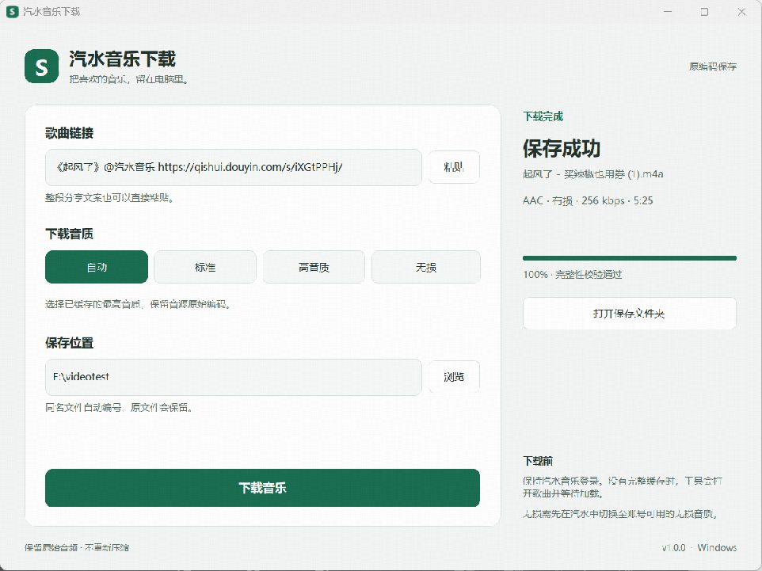

# 汽水音乐下载

保留原始音频编码的 Windows 单曲下载工具。粘贴分享链接，选择音质和目录，保存官方客户端已完整缓存的音乐。

**Windows x64** · [下载最新版](https://github.com/kyirexy/qishuimusic-download/releases/latest) · [v1.0.0](https://github.com/kyirexy/qishuimusic-download/releases/tag/v1.0.0) · [更新记录](CHANGELOG.md)



*v1.0.0 实际运行截图：AAC 有损音源保存完成。*

## 快速开始

### 1. 下载工具

在 [Releases](https://github.com/kyirexy/qishuimusic-download/releases/latest) 下载 Windows x64 ZIP，解压后运行 `SodaMusicDownloader.exe`。发布包已包含 Python 和缓存读取运行时，无需自行安装 Python 或 Node.js。

需要安装并登录 **汽水音乐电脑版**。当前适配和验证基于汽水音乐 **3.7.0**。

### 2. 安装 FFmpeg

音频保存与校验需要 **FFmpeg 和 FFprobe**，发布包不包含这两个程序。可在终端执行：

```powershell
winget install --id Gyan.FFmpeg --exact
```

安装后重新打开工具。也可以从 [FFmpeg 官网](https://ffmpeg.org/download.html) 获取 Windows 版本，将 `ffmpeg.exe` 和 `ffprobe.exe` 所在文件夹加入 `PATH`，或把这两个文件放到 `SodaMusicDownloader.exe` 旁边的 `tools` 文件夹。

### 3. 保存一首歌

1. 在汽水音乐中复制单曲分享链接，也可以复制整段分享文案。
2. 粘贴到工具中，选择保存位置，首次使用建议保留“自动”音质。
3. 点击“下载音乐”。已有完整缓存时直接保存；没有时会打开官方播放器中的歌曲，等待最多两分钟。
4. 完成后查看实际编码、码率和时长，点击“打开保存文件夹”。

等待时保持汽水音乐登录并正常加载歌曲。任务可以取消，同名文件自动增加序号，原文件会保留。

## 音质选择

| 选项 | 如何选择音源 |
| --- | --- |
| **自动** | 优先已缓存的 FLAC，否则选择码率最高的有损音源 |
| **标准** | 选择已缓存的最低码率有损音源 |
| **高音质** | 选择已缓存的最高码率有损音源 |
| **无损** | 只保存 FLAC；没有时提示先在汽水中加载无损音源 |

选项是本工具的缓存选择策略，不代表平台固定档位，也不会强制切换官方播放器音质。只有一份有损缓存时，“标准”和“高音质”可能相同。

普通账号可以保存官方客户端已获取的完整音源，会员专属歌曲仍取决于账号和歌曲权限。汽水音乐 3.7.0 的“无损音质”标为 **SVIP**，普通 VIP 不保证有 FLAC；实际以官方客户端显示的权益为准。

## 常见问题

**为什么下载的是 M4A，而不是 MP3？**

工具保留音源原来的编码：AAC 保存为 `.m4a`，MP3 为 `.mp3`，Opus 为 `.opus`，FLAC 为 `.flac`。把 AAC 转成 MP3 会再次进行有损压缩，因此工具直接保存 AAC 音频。**M4A 是容器格式，不等于无损**，完成信息会显示实际编码。

**为什么选择无损后没有保存？**

请先在汽水音乐里选择账号可用的无损音质，并让这首歌完成加载。没有 FLAC 缓存时，工具不会改用 AAC，也不会把有损音源转换为 FLAC。

**为什么一直等待，或者提示只有试听？**

先确认这首歌能在官方客户端完整播放，并等待缓冲完成。试听片段、尚未完整的缓存或校验失败的音频不会被当作完整歌曲保存。

## 工作方式

官方客户端负责登录、歌曲权限和正常播放加载。工具只读访问本机播放缓存，匹配歌曲和音源，检查完整标记、文件长度、实际编码及完整解码时长，再保存原始音频。

- 桌面流程无需输入账号、密码、Cookie 或 sessionid，不读取登录凭证。
- 分享短链接解析可能联网；歌曲加载由官方客户端完成，不复用缓存中的签名音源网址。
- 设置只保存输出目录和音质选择；不保存分享文本或歌曲历史。
- 现有缓存反映此前的官方获取结果，工具不实时查询会员状态，也不修改客户端或会员权益。

这是独立项目，与汽水音乐官方无隶属关系。官方客户端更新或清理缓存后，可能需要重新适配或加载歌曲。

## 验证情况

**107 项自动化测试全部通过，无跳过。** 正式 Windows EXE 已通过启动冒烟和默认布局检查；真实 AAC 保存流程已验证。**FLAC 目前仅完成合成音频验证，尚未完成真实歌曲的 FLAC 端到端验收。**

详见 [验证记录](VERIFICATION.md)。编码与解码校验能检查文件完整性，不能判断发行方母带是否曾经过有损编码。

<details>
<summary><strong>源码运行、测试与构建</strong></summary>

需要 **Python 3.11.x x64**、**PowerShell 7** 和 FFmpeg。Windows CI 配置使用 Python 3.11.9，构建信息记录实际 Python 版本。

克隆本仓库后，在项目目录执行：

```powershell
py -3.11 -m venv .venv
.\.venv\Scripts\python.exe -m pip install -r requirements.txt
pwsh -NoProfile -File .\scripts\prepare-cache-runtime.ps1
.\.venv\Scripts\python.exe app.py
```

缓存准备脚本下载固定版本的 Node.js 22.19.0，校验官方压缩包 SHA-256，再按锁文件安装 lmdb-js 3.5.8 等依赖。界面使用 CustomTkinter 5.2.2。

运行测试与界面冒烟：

```powershell
.\.venv\Scripts\python.exe -m unittest discover -s tests -v
.\.venv\Scripts\python.exe app.py --smoke-test
```

构建 Windows 发布包：

```powershell
pwsh -NoProfile -File .\build.ps1 -Version 1.0.0
```

构建脚本创建独立的 `.venv-build` 环境，安装带哈希校验的固定依赖，运行测试并打包。EXE、ZIP、`BUILD-INFO.json` 和 `checksums.txt` 生成在 `dist/release`。FFmpeg / FFprobe 仍为外部依赖。

产品范围与界面说明见 [PRODUCT.md](PRODUCT.md)、[DESIGN.md](DESIGN.md)。

</details>

## 致谢与许可

参考了 [SodaDownloader](https://github.com/baizeyv/SodaDownloader) 的早期单曲请求结构及音源字段处理。第三方许可见 [THIRD_PARTY_NOTICES.txt](THIRD_PARTY_NOTICES.txt)，运行时组件许可随发布包保留。

[汽水音乐官网](https://www.qishui.com/) · [汽水音乐用户协议](https://luna-web.douyin.com/terms)
